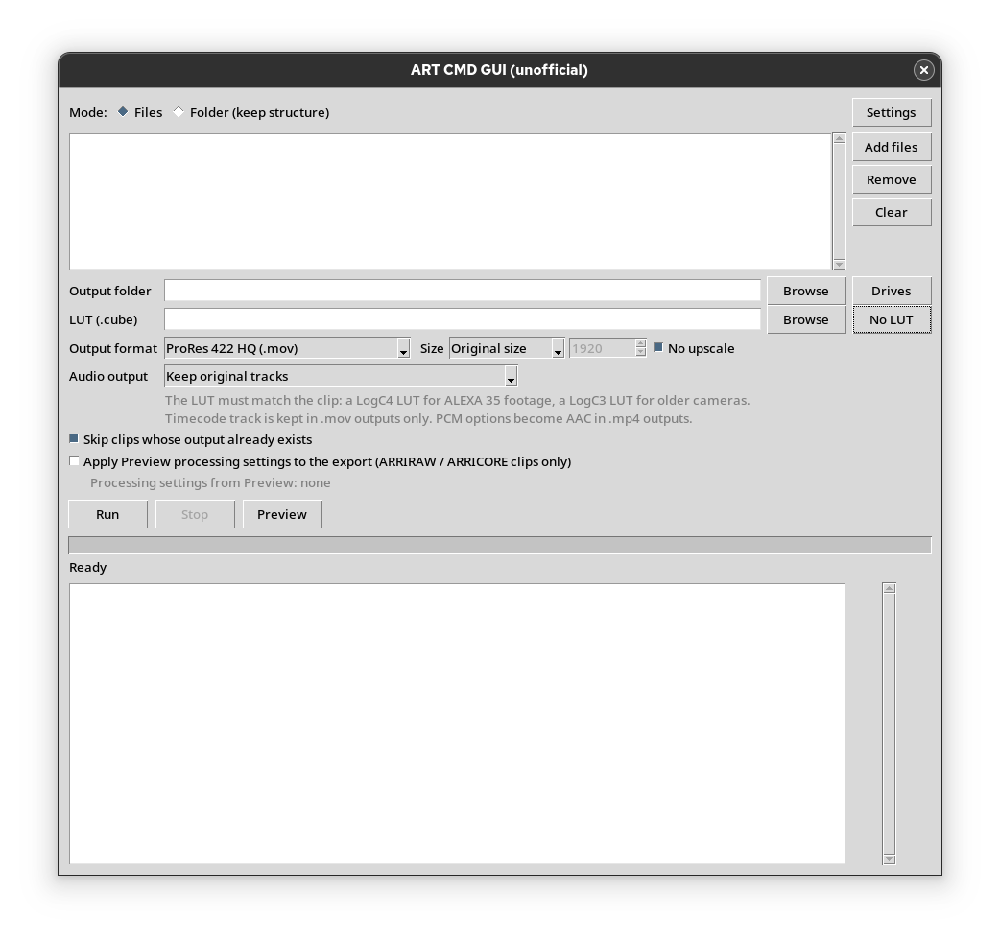

# art-cmd-gui (unofficial)

A small Tkinter front end for ARRI's command-line tool **ARRI Reference Tool CMD** (`art-cmd`) on Linux.
It turns ARRI clips into editing-friendly files in batches, with a before/after preview.

> **Not affiliated with, endorsed by, or supported by ARRI.** "ARRI" and "ALEXA" are trademarks of their owners.
> This repository contains **no ARRI software, LUTs, schema files or footage**. You must download
> `art-cmd` yourself from ARRI and accept its license (see [ARRI's page](https://www.arri.com/en/learn-help/learn-help-camera-system/tools/arri-reference-tool)).
> Please read the license that ships with it; its terms are between you and ARRI.

This project was written with the help of Claude, an AI assistant made by Anthropic.



## Features

- Batch conversion of ARRI clips (MXF/ARRIRAW, ARRICORE, ProRes) with `art-cmd`, then `ffmpeg` for the final file
- **Files mode** (pick clips) or **Folder mode** (scans a folder and recreates the same folder tree in the output folder)
- Output formats: ProRes (Proxy, LT, 422, HQ, 4444, 4444 XQ), DNxHR (HQ, HQX, 4:4:4), H.264/H.265 proxies.
  Only formats your `ffmpeg` can encode are listed.
- Optional `.cube` LUT, for example ARRI's official LogC4 to Rec.709 LUT
- Audio options: keep, PCM 24/16-bit, AAC, stereo from two mono tracks, or none
- Output size by width, height or percent, always keeping the aspect ratio (optional "no upscale")
- **Preview** window: any frame before/after the LUT, frame slider with timecode, auto-render when something changes
- **Processing panel** for ARRIRAW/ARRICORE (exposure index, color temperature, tint, debayer mode). Sliders start at the
  values stored in the clip; only the values you change are sent to `art-cmd` (as a `--parameters` JSON file)
- Drive picker for external disks, hidden folders are hidden in file dialogs
- A failing clip never stops the batch; failures are listed at the end

## Requirements

- Linux (developed on Rocky Linux 10 with the RHEL 9 build of `art-cmd`)
- Python 3.9+ with tkinter
- `ffmpeg` and `ffprobe`
- ARRI Reference Tool CMD, downloaded from ARRI

## Install

```bash
git clone <this repository>
cd <folder>
./install.sh
```

`install.sh` copies the script to `~/.local/share/art-gui` and adds an "ART GUI (unofficial)" entry to your application menu.
No root needed. Remove it with `./uninstall.sh`. You can also just run `python3 art_gui.py`.

Missing tkinter: `sudo dnf install python3-tkinter` (Fedora/Rocky), `sudo apt install python3-tk` (Debian/Ubuntu), `sudo pacman -S tk` (Arch).

## First run

1. Download and extract ARRI Reference Tool CMD from ARRI.
2. Start the program. It looks for `art-cmd` in `$ART_CMD`, your saved setting, `PATH`, and a few common folders
   (`~/art-cmd*`, `~/Downloads/...`, `/opt`). If it is not found, **Settings** opens: select the `art-cmd` program there.
3. Optionally set a default LUT in Settings. Settings are stored in `~/.config/art-gui/config.json`.

## Usage notes

- **The LUT must match the clip.** A LogC4 LUT is for ALEXA 35 footage; older cameras record LogC3 and need a LogC3 LUT.
- Processing settings apply to ARRIRAW/ARRICORE only. ProRes clips are not affected (the log says so).
  To use the preview settings in a batch, tick the option in the main window.
- `.mov` outputs keep the clip's timecode track; `.mp4` outputs do not.
- Files that `art-cmd` cannot read (for example a `.mov` made by another program) are reported as failed.

## Status and limitations

Early version (0.1.0), developed and tested by one person on one system: Rocky Linux 10.2 (GNOME), `art-cmd` 1.1.1,
using ARRI's public ALEXA 35 sample clips (ProRes and a one-frame ARRIRAW).

Checked: ProRes 422 HQ and Proxy outputs with a LUT, timecode preserved, stereo/no-audio options, folder mode with sub-folders,
size by percent, preview and processing panel on ARRIRAW, drive picker.

Not tested yet: DNxHR, ProRes 4444, H.264/H.265 outputs, size by width/height inside the GUI, ARRICORE, multi-frame ARRIRAW,
LogC3 workflows, other distributions and desktops.

Known limitations:
- Only `.mxf` and `.mov` clips are found. `.ari`/`.arx` frame sequences are not supported yet.
- Drop-frame timecode is not calculated in the preview.
- Each preview render runs `art-cmd` on one frame, so it is not real-time playback.

Bug reports and pull requests are welcome.

## Legal note (not legal advice)

ARRI Reference Tool CMD is licensed by ARRI under its own end user license agreement. That agreement is governed
by German law and says the software is licensed to you as an entrepreneur (professional use), not as a consumer.
Read it before using the tool. This project only starts `art-cmd` as a separate program; it does not include,
copy or modify it. The authors are not lawyers. Other laws and terms (for example export or sanctions rules, or the
terms of a service you use) may also apply to you; please check them yourself.

## License

The code in this repository is released under the MIT license (see `LICENSE`).
It does not cover ARRI Reference Tool CMD, ARRI LUT packages or ARRI footage.
